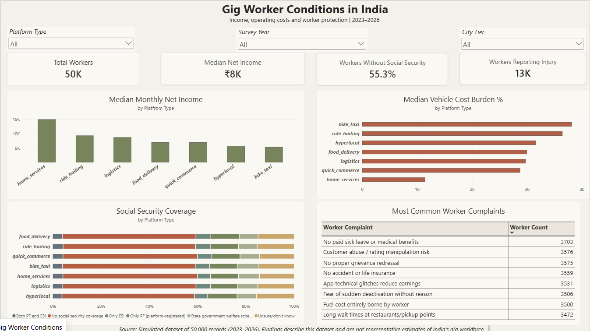
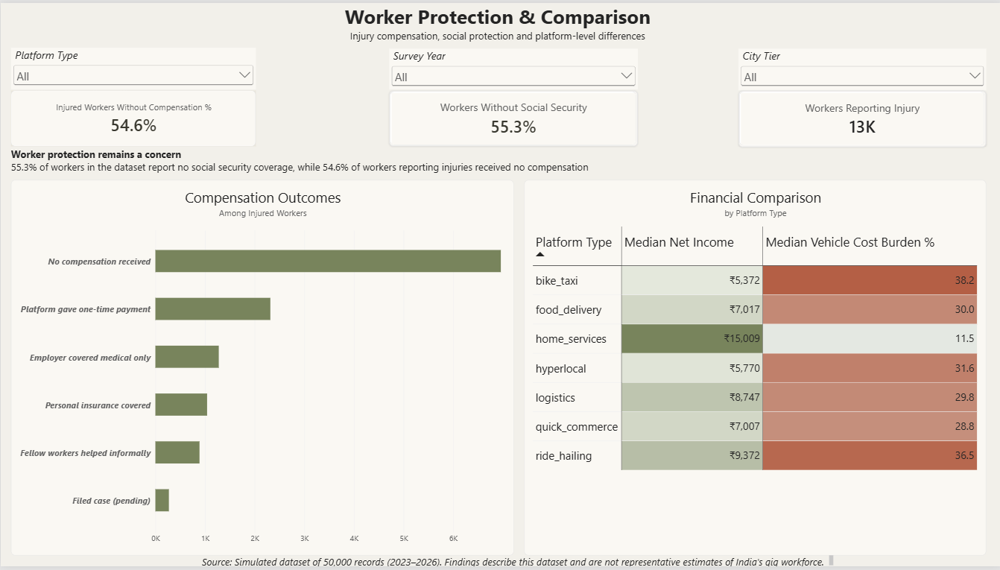

# India Gig Worker Analysis

An end-to-end data analysis project exploring income, operating costs, social security coverage, and injury compensation among gig and platform workers in a simulated dataset of 50,000 records spanning 2023–2026.

## Dataset

Source: [India Gig and Platform Economy Worker Dataset (2023–2026)](https://www.kaggle.com/datasets/mansiaggarwal88/india-gig-and-platform-economy-worker-20232026)  

## Dashboard Preview

### Gig Worker Conditions

### Worker Protection & Comparison

## Key Findings

- **Social security:** 55.3% of records indicate no social security coverage.
- **Injury compensation:** Among workers reporting injuries, 54.6% had no compensation recorded.
- **Vehicle cost burden:** Median vehicle cost burden varied by platform type, from approximately 11.5% for home services to 38.2% for bike taxi.
- **Income differences:** Median net income varied considerably across platform types.

These findings describe the supplied simulated dataset and should not be interpreted as representative estimates of India's gig workforce.

## Tools Used

- Python
- Pandas and Jupyter Notebook
- SQL and PostgreSQL
- Power BI

## Project Structure

- `data/` — original and cleaned datasets
- `notebooks/` — exploratory data analysis, cleaning, and analysis
- `sql/` — SQL queries for income, social security, injury compensation, and vehicle costs
- `powerbi/` — Power BI report
- `screenshots/` — dashboard screenshots
- `video/` — dashboard walkthrough

## Workflow

1. Explored the dataset and assessed data quality.
2. Cleaned missing values and standardized selected categories.
3. Analyzed income, vehicle operating costs, social security coverage, and injury compensation using Python and SQL.
4. Built an interactive two-page Power BI dashboard with KPI cards, charts, a comparison matrix, and slicers.

## Limitations

The dataset is simulated. Its patterns and percentages are not evidence of the actual prevalence of these conditions among India's gig workers. Some missing values were handled using assumptions documented during data cleaning.

## How to Explore

1. Review the notebooks in order, from `01_eda.ipynb` to `03_analysis.ipynb`.
2. Inspect the SQL queries in `sql/`.
3. Open the Power BI report in Power BI Desktop to explore the dashboard interactively.
